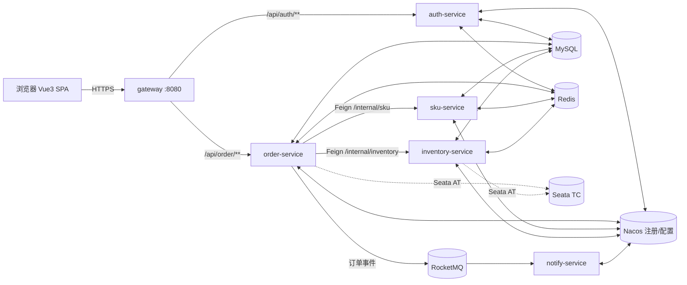

# 系统架构约束

> 本文档说明**不可随意变更的结构性约束**。改动架构必须先在 `docs/adr/` 新增决策记录。

## 1. 总体结构

## 2. 服务职责边界（谁管什么数据）

| 服务 | 拥有数据 | 禁止 |
|---|---|---|
| gateway | 无 | 写业务逻辑、直连 DB |
| auth | `sys_user` `sys_role` `sys_perm` | 管业务数据 |
| order | `t_order` `t_order_item` | 直连 sku/inventory 的库 |
| sku | `t_sku` `t_spu` | 改订单状态 |
| inventory | `t_stock` `t_stock_log` | 读订单表 |
| notify | 无（消费消息） | 同步阻塞业务流程 |

**核心原则**：一个数据只有一个"属主服务"。其他服务只能通过 Feign 或 MQ 获取。

## 3. 调用约定

- 对外接口：`/api/v1/**`，网关统一前缀转发，JWT 校验在网关。
- 内部接口：`/internal/**`，网关黑名单屏蔽，调用方认证靠 `X-Internal-Token` + 网络隔离。
- 同步调用只用于"必须立即知道结果"的场景；能被最终一致的走 MQ。
- 所有远程调用必须有超时（连接 1s / 读 3s）、重试（仅幂等读，最多 1 次）、降级。

## 4. 一致性策略（重要）

| 业务 | 策略 |
|---|---|
| 创建订单 + 扣库存 | 强一致 → Seata AT（有 undo_log，30s 超时） |
| 订单完成后加积分 | 最终一致 → Outbox 表 + RocketMQ |
| 商品信息同步到搜索 | 最终一致 → binlog 订阅 / MQ |
| 用户注册后发欢迎邮件 | 最终一致 → MQ |

原则：**能最终一致就不要 Seata**。使用 Seata 必须写 ADR，并说明为什么不能接受最终一致。

## 5. 配置与注册

- Nacos 命名空间按环境隔离：`dev` / `test` / `prod`（用 ID，不要用名字）。
- 分组：`DEFAULT_GROUP` 只放公共配置；业务配置用 `GROUP=<domain>`。
- `application.yml` 只放默认值；**环境相关与敏感值走环境变量**。
- 动态配置改动必须记录到 `docs/runbooks/config-change.md`。

## 6. 前端结构

- 单个 SPA（`apps/web`），按业务域拆路由与目录。
- 共享代码放 `packages/`：`ui`（业务无关组件）、`api-client`（请求封装）、`shared-types`（与后端 DTO 对齐的类型）、`utils`。
- `packages/shared-types` 的类型是**契约**：后端改字段必须同步改这里，否则 CI 的契约检查失败。

## 7. 环境

| 环境 | 用途 | 数据 |
|---|---|---|
| local | 本地开发 | docker compose，可随意改 |
| dev | 联调 | 每日可重置 |
| test | QA | 脱敏数据 |
| prod | 生产 | 唯一真实数据，**禁止直连调试** |

## 8. 可观测性

- 全链路 traceId：网关生成 → 透传 header `X-Trace-Id` → 日志 MDC → 返回体 `traceId` 字段。
- 指标：每个服务暴露 `/actuator/prometheus`，关键接口打 `http_server_requests` 标签。
- 告警阈值与处置方法见 `docs/runbooks/`。